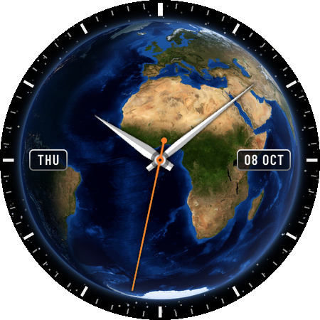

# Wear OS watch faces

Watch faces for Wear OS, built with Claude, along with the guides and scripts used to make them. Each face is a self-contained Android Studio project using Google's [Watch Face Format](https://developer.android.com/training/wearables/wff). The faces are tested on a Galaxy Watch 6.

## Faces

| | Face | Description | Version |
|---|---|---|---|
|  | **[Earth Day & Night](faces/earth-day-night/)** | The Earth from space with live daylight, twilight and city lights at night. Day and date windows, four hand styles, colour options. | 1.2.2 (WFF v1) |

## Repository layout

```
.
├── README.md                    this page
├── CLAUDE.md                    conventions for Claude when working in this repository
├── docs/
│   ├── agentic-wear-os-watch-faces.md   how to build watch faces with an AI agent
│   └── install-on-galaxy-watch.md       install, update and debug any face (Windows)
├── tools/                       shared scripts (Python 3.9+, numpy, pillow)
│   ├── validate_wff.py          checks XML against Google's official schema
│   ├── check_generated.py       checks committed images/XML match a fresh rebuild
│   ├── wff_lint.py              checks the schema can't do (nested settings, missing images…)
│   ├── wff_sim.py               renders a face from its XML for previews and tests
│   └── new_face.py              starts a new face from the template
├── .github/workflows/checks.yml automatic checks on every pull request
├── templates/
│   └── analog/                  Google's SimpleAnalog sample, the starting point for new faces
├── faces/
│   └── earth-day-night/         one folder per watch face (a complete Android Studio project)
└── licenses/                    licence texts for third-party material
```

## Quick start

**Install a face on the watch.** Open its folder (for example `faces/earth-day-night`) in Android Studio and follow [docs/install-on-galaxy-watch.md](docs/install-on-galaxy-watch.md).

**Rebuild a face after changing its scripts** (Earth Day & Night as the example):
```bash
pip install numpy pillow
cd faces/earth-day-night
python tools/build.py
python ../../tools/validate_wff.py watchface/src/main/res/raw/watchface.xml
```

**Start a new face:**
```bash
python tools/new_face.py moon-phase "Moon Phase"
```
This creates `faces/moon-phase/` with its own package name, so it installs alongside the others.

## Working with Claude

[docs/agentic-wear-os-watch-faces.md](docs/agentic-wear-os-watch-faces.md) covers:
- how to split the work between you and Claude
- the format pitfalls to watch for
- the check-and-test loop: validate, lint, preview, install, read logs

[CLAUDE.md](CLAUDE.md) holds the rules Claude should follow in this repository. When you start a new face, describe the idea, your watch and how you want to review it, and point Claude at this repository.

## Conventions

- **One folder per face** under `faces/`, each a complete Gradle project with its own `applicationId`. Open the face's folder in Android Studio, not the repository root.
- **Generated files aren't edited by hand.** Where a face has a `tools/` folder, its `watchface.xml`, `strings.xml` and images come from those scripts. Change the scripts and rebuild.
- **Before each install or release:** run `validate_wff.py` and `wff_lint.py` (a face's `build.py` may do the lint for you), and increase `versionCode` and `versionName` in `watchface/build.gradle.kts`.
- **Changes go through pull requests.** `main` is protected, and the **Checks** workflow runs on every PR and every push to `main`. For each face and the template it:
  - lints the XML and validates it against Google's schema
  - rebuilds every face that has a `tools/build.py` and runs that face's own checks
  - fails if the committed images or XML differ from a fresh build

  Each run's preview renders are attached as a downloadable **previews** artifact.
- **Releases** can be tagged as `<face>-v<version>`, for example `earth-day-night-v1.2.1`.

## Licences

This repository's own code, docs and artwork are under the [MIT License](LICENSE). Third-party material keeps its own licence; see [THIRD_PARTY_NOTICES.md](THIRD_PARTY_NOTICES.md).
