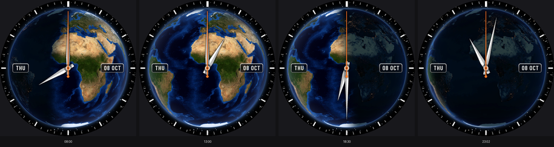
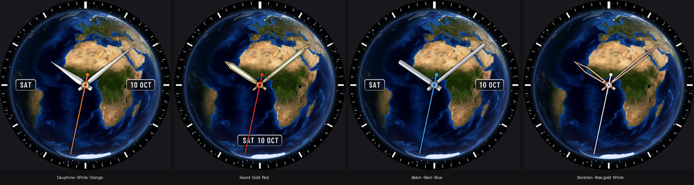

# Earth Day & Night

An analogue watch face showing the Earth from space above the equator at Greenwich (0°N 0°E), with Europe and the UK towards the top. It shows daylight, dusk, and the night side with city lights as they are right now. The day/night line follows the real position of the Sun, including the seasons.



- **Version:** 1.2.1 (versionCode 4)
- **Package:** `uk.earthface.daynight`
- **Watch Face Format:** version 1, so it runs on Wear OS 4 and later. Tested on a Galaxy Watch 6.

**[GUIDE.md](GUIDE.md)** explains how the face works and how to change and rebuild it.

## Install
Open this folder (`faces/earth-day-night`) in Android Studio, then follow [docs/install-on-galaxy-watch.md](../../docs/install-on-galaxy-watch.md).

## Customising it
Long-press the face and tap **Customise**, or use the Galaxy Wearable app on your phone.

| Setting | Options |
|---|---|
| Hand style | Dauphine, Sword (with lume insert), Baton, Skeleton (open, so you can see the Earth through it) |
| Hand colour | White, Steel, Gold, Rose gold |
| Seconds hand colour | Orange, Red, Yellow, Blue, White |
| Seconds hand | On / Off |
| Date | Day and date apart (day at 9 o'clock, date at 3), One window at 6, or Off |

The date always uses English capitals (for example THU and 08 OCT), whatever language the watch is set to.



## What you'll see
- **Daytime:** the sunlit half of the globe, with the boundary moving smoothly through the day. Around midday at Greenwich, almost the whole disk is lit.
- **Dusk and dawn:** a soft twilight band. City lights appear as it darkens.
- **Night:** the dark globe with city lights. The continents stay faintly visible.
- **Always-on display:** a dimmed night view with the hour and minute hands and a dimmed date. The seconds hand is hidden to save battery and avoid screen burn-in.

## Rebuild after changing something
From this folder, run:
```bash
pip install numpy pillow
python tools/build.py
python ../../tools/validate_wff.py watchface/src/main/res/raw/watchface.xml
```
Then increase `versionCode` in `watchface/build.gradle.kts` and install. The details are in [GUIDE.md](GUIDE.md), section 5.

## Credits
- Earth imagery: NASA Blue Marble and NASA Earth at Night (public domain), via the copies in [vasturiano/three-globe](https://github.com/vasturiano/three-globe).
- Date lettering: Barlow Condensed by The Barlow Project Authors (SIL Open Font License 1.1). The font is in `inputs/` with its licence; the face itself contains only pre-rendered images.
- Gradle setup and wrapper: Google's Wear OS Watch Face Format samples (Apache License 2.0).
